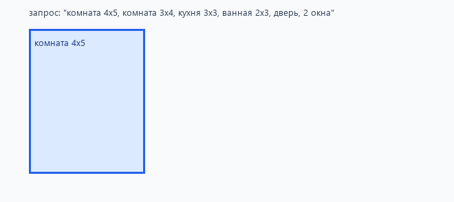
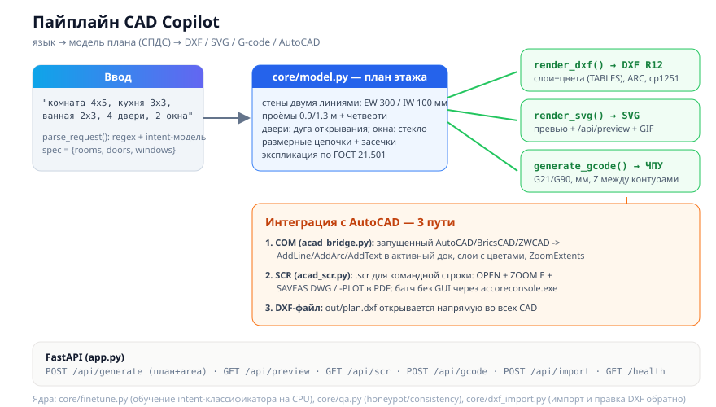

# CAD Copilot — генерация DXF-чертежей и G-code по текстовому запросу


Офлайн-движок превращает запрос вида **«комната 4x5, кухня 3x3, ванная 2x3, дверь, 2 окна»**
в спецификацию, раскладку комнат и чертёж сразу в трёх форматах: **DXF R12**
(открывается в AutoCAD/BricsCAD), **SVG-превью** и **G-code для ЧПУ**. Плюс
обратный путь — импорт и редактирование существующих DXF (сдвиг/удаление комнат по слоям).

## Демо (реальные запуски, не мок-up)

Анимация собрана из реального вывода `layout()` (`skrin/gen_demo_gif.py`):



| Артефакт | Источник |
|---|---|
| `skrin/plan.svg` | вывод `python demo.py` → `out/plan.svg` |
| `skrin/demo.gif` | кадры из `layout()` на запросе из `demo.py` |
| `skrin/loss_curve.svg` | stdout лога `python core/finetune.py` (12 эпох) |
| `skrin/api.png` | скрин Swagger UI живого сервера (`uvicorn app:app`) |

## Архитектура



## Что внутри

| Модуль | Что делает |
|---|---|
| `core/autocad_ai.py` | парсер запроса → spec → раскладка → DXF R12 + SVG. DXF-writer без зависимостей (секции LINE/TEXT по протоколу R12), при наличии `ezdxf` — через него |
| `core/gcode.py` | тот же `layout()` → G-code: G21/G90, миллиметры, G0-переезды между контурами, комментарий `; ROOM` на каждый контур — готов для лазерного гравера/плоттера |
| `core/dxf_import.py` | стрим-парсер DXF R12 → линии по слоям → bbox комнат; `shift_room()`, `remove_room()`, `save_dxf()` — редактирование существующих чертежей |
| `core/finetune.py` | генерация датасета (240 примеров, 5 интентов), обучение softmax-классификатора (bag-of-words, SGD) на CPU; результат — `model/intent_model.json` |
| `core/qa.py` | QA данных и модели: honeypot-выборки, consistency-check, отчёт `data/qa_report.json` |
| `app.py` | FastAPI: `/api/generate`, `/api/preview`, `/api/gcode`, `/api/import`, `/health` |
| `tests/` | 10 тестов: парсер, DXF-пайплайн, SVG, обучение, QA, G-code, импорт/редактирование DXF (roundtrip) |

## Быстрый старт

```bash
pip install -r requirements.txt
python demo.py                            # out/plan.dxf + out/plan.svg
uvicorn app:app --port 8090               # Swagger: http://127.0.0.1:8090/docs
pytest tests/ -q                          # 10 passed
```

## API

```bash
curl -X POST localhost:8090/api/generate -H "Content-Type: application/json" \
  -d '{"text": "квартира: комната 4x5, кухня 3x3, дверь, 2 окна"}'
# → {"spec": {...}, "dxf": "out/plan.dxf", "svg": "out/plan.svg",
#    "rooms": 2, "doors": 1, "windows": 2}

curl -X POST localhost:8090/api/gcode -H "Content-Type: application/json" \
  -d '{"text": "комната 4x5, кухня 3x3"}'
# → G21 ; millimeters
#   G90 ; absolute
#   ; ROOM komnata 4.0x5.0
#   G0 X0.0 Y0.0 F3000
#   G1 Z-1.0 F600 ; plunge
#   G1 X4000.0 Y0.0 F1200
#   ...

curl -F "file=@out/plan.dxf" localhost:8090/api/import
# → {"rooms": [...], "layers": ["KOMNATA", "KUHNYA"], "lines": 8}
```

## Модель и обучение

`python core/finetune.py` — реальное CPU-обучение, не заглушка:

1. **Датасет**: 240 примеров на 5 интентов из шаблонов с рандомными размерами → `data/finetune.jsonl`.
2. **Признаки**: bag-of-words, словарь собирается по всей выборке.
3. **Модель**: softmax по парам «класс×слово», SGD, lr=0.5, сплит 80/20 (seed=3).
4. **Метрики**: кросс-энтропийный лосс и val accuracy печатаются за каждую эпоху —
   ими же построен график выше.
5. **Артефакт**: `model/intent_model.json`; `core/qa.py` гоняет модель по
   honeypot-выборке (pass rate 1.0) и consistency-проверкам.

Сервис работает на офлайн-правилах: модель подключается как дополнительный
ранкер поверх парсера, без даунтайма. `--lora` — QLoRA-трек (`torch + peft` +
локальная LLM), пайплайн `train_lora()` готов в `core/finetune.py`.

## CI

GitHub Actions на каждый push: `pip install` → `python demo.py` → `pytest tests/ -q`.
Все 10 тестов проходят на чистом окружении без GPU и без интернета.

## Что дальше

- [ ] Полный LoRA-трек: обученный адаптер к локальной LLM через llama.cpp
- [ ] Telegram-бот: фото эскиза → чертёж
- [ ] Экспорт этажей: несколько спецификаций → один DXF с уровнями

MIT License
