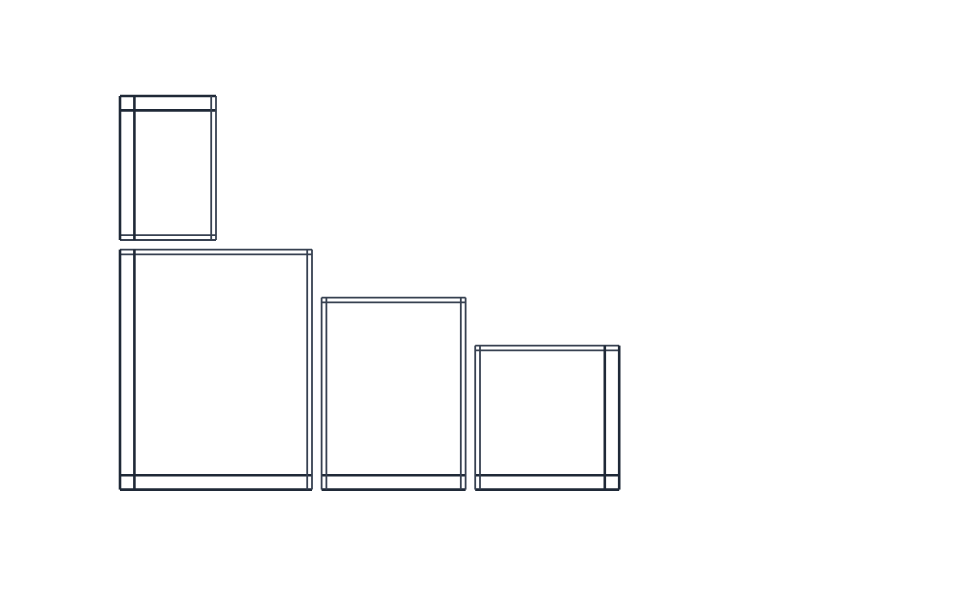
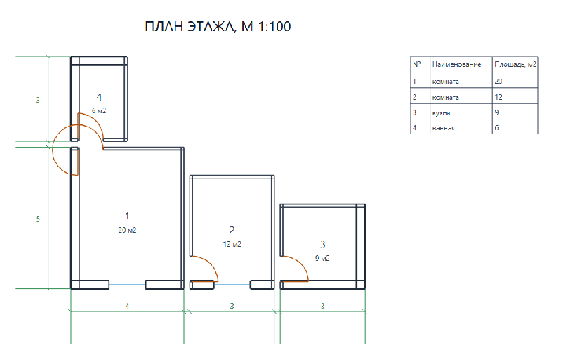
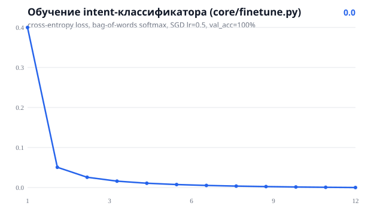

# CAD Copilot — NL в†’ архитектурный план в†’ DXF / G-code / AutoCAD


Запрос **«комната 4x5, комната 3x4, кухня 3x3, ванная 2x3, 4 двери, 2 окна»** превращается
в параметрическую модель плана этажа: стены с реальной толщиной (наружные 300 мм,
перегородки 100 мм), дверные проёмы с дугами открывания, окна со стеклом, размерные
цепочки с засечками, экспликация помещений — и экспорт в **DXF R12** (слои, цвета,
ASCII + cp1251), **SVG**, **G-code** и **AutoCAD-скрипты**.

## Результат (кадры из живого пайплайна)



Финальный кадр (рендер того же SVG, что уходит в DXF — рендеры делят один набор
примитивов, чертёж в AutoCAD и превью не расходятся):



| Артефакт | Источник |
|---|---|
| `skrin/plan_v2.gif` / `plan_v2.png` | этапы `build_plan()` → SVG → headless Edge → PNG (`skrin/gen_plan_gif.py`) |
| `skrin/api.png` | Swagger UI живого сервера |
| `skrin/loss_curve.svg` | stdout лога `python core/finetune.py` (12 эпох) |

## Верификация без установленного AutoCAD (3 уровня)

1. **Структурный валидатор** `tools/verify_dxf.py`: перечитывает порождённый DXF
   независимым парсером (баланс SECTION/ENDSEC, коды групп, конечные координаты,
   ARC/TEXT-атрибуты, известные слои) + инварианты против модели (ARC = числу дверей).
2. **`ezdxf` как второе мнение**: `doc.audit()` эталонной независимой реализацией
   читателя DXF — 0 ошибок, reopen без проблем (тест `test_verify_dxf_roundtrip`).
3. **Реальный AutoCAD на твоей машине** — `tools/e2e_autocad.py`: генерирует план,
   ищет `accoreconsole.exe`, прогоняет батч `OPEN DXF → SAVEAS DWG` (→ `plan.dwg`)
   и `-PLOT` в PDF, печатает PASS/FAIL:
   ```bash
   python tools/e2e_autocad.py --plot      # или --acad "D:\...\accoreconsole.exe"
   ```

Docker-образ (`Dockerfile`) и CI-job `docker` собирают чистое окружение, в котором
`demo.py` + валидатор + все тесты гоняются на каждом пуше — то же, что увидит
работодатель, склонировав репо.

## Интеграция с AutoCAD (3 пути, `skrin/architecture.svg`)

| Путь | Модуль | Когда использовать |
|---|---|---|
| **COM** | `core/acad_bridge.py` | AutoCAD/BricsCAD/ZWCAD запущен → примитивы рисуются напрямую в активном документе (`AddLine`/`AddArc`/`AddText`), слои создаются с цветами, `ZoomExtents`. Логика моста покрыта тестами через duck-typed fake |
| **SCR** | `core/acad_scr.py` | любой AutoCAD, в т.ч. без GUI: `.scr` = `OPEN` + `ZOOM E` + `SAVEAS DWG` / `-PLOT` в PDF. Батч на сервере: `accoreconsole.exe /i out/plan.dxf /s out/acad_open.scr` |
| **DXF** | `out/plan.dxf` | просто открыть файл: R12 читают AutoCAD, BricsCAD, nanoCAD, DraftSight, LibreCAD |

Обратный путь — `core/dxf_import.py`: стрим-парсер DXF → линии по слоям → комнаты,
`shift_room()` / `remove_room()` / `save_dxf()` — правка готового чертежа, POST `/api/import`.

## Что автоматизирует (сэкономленные человекочасы, а не «магия ИИ»)

* NL → геометрия: раскладка комнат, стены, проёмы — минуты вместо часа черчения;
* размерные цепочки и экспликация пересчитываются при любом изменении площадей;
* продакшн-форматы из одного источника: DXF + SVG + G-code + SCR;
* intent-модель (bag-of-words softmax, CPU) ранжирует команды поверх regex-парсера;
* QA-модуль (`core/qa.py`): honeypot + consistency для датасета и модели.

## Архитектура


## Что внутри

| Модуль | Назначение |
|---|---|
| `core/model.py` | план этажа: стены 2 линиями (EW 300 / IW 100 мм), проёмы 0.9/1.3 м + четверти, двери (ARC дуга 90°) + полотно, окна (стекло по центру толщины), размерные цепочки + засечки, экспликация, слои-транслит (`Steny`, `Peregorodki`, `Dveri`, `Okna`, `Razmery`, `Explication`) |
| `core/render.py` | DXF R12 (HEADER/TABLES/ENTITIES, слои+цвета, TEXT cp1251) и SVG — над одним списком примитивов |
| `core/autocad_ai.py` | regex-парсер запроса → spec; layout() упаковка в контейнер 12 м |
| `core/finetune.py` | генерация датасета (240, 5 интентов) + обучение softmax (bag-of-words, SGD) на CPU |
| `core/qa.py` | honeypot-выборки, consistency, отчёт `data/qa_report.json` |
| `core/acad_bridge.py`, `core/acad_scr.py` | см. «Интеграция с AutoCAD» |
| `core/gcode.py` | контуры комнат → G-code: G21/G90, мм, G0-переезды, `; ROOM` |
| `core/dxf_import.py` | DXF → линии по слоям → комнаты; edit: shift/remove |
| `app.py` | FastAPI v2: `/api/generate` (план + площади + SCR), `/api/preview`, `/api/scr`, `/api/gcode`, `/api/import`, `/health` |
| `tests/` | 17 тестов: геометрия модели (толщины, вырезы проёмов, стекло), DXF/SVG консистентность, COM-мост на fake-объекте, SCR, G-code, QA, парсер |

## Быстрый старт

```bash
pip install -r requirements.txt
python demo.py        # out/plan.dxf + plan.svg + acad_open.scr + acad_plot.scr
uvicorn app:app --port 8090     # Swagger: /docs
pytest tests/ -q      # 20 passed
```

## API

```bash
curl -X POST localhost:8090/api/generate -H "Content-Type: application/json" \
  -d '{"text": "комната 4x5, комната 3x4, кухня 3x3, ванная 2x3, 4 двери, 2 окна"}'
# → {"rooms": [{"№":1,"name":"комната","area":20}, ...], "area_total": 47.0,
#    "prims": 128, "dxf": "out/plan.dxf",
#    "scr": ["out/acad_open.scr", "out/acad_plot.scr"]}

curl localhost:8090/api/scr        # .scr для AutoCAD (kind=plot → +PDF)
curl -F "file=@out/plan.dxf" localhost:8090/api/import
```

## Модель и обучение

`python core/finetune.py`: 240 примеров → 5 интентов, bag-of-words + softmax + SGD
(lr=0.5, 12 эпох), сплит 80/20, метрики за эпоху: loss 0.39 → 0.006, val_acc 100%.
`core/qa.py` проверяет модель по honeypot-выборке (pass rate 1.0).



## CI

GitHub Actions на каждый push: `pip install` → `demo.py` → `pytest -q` — чистое
Linux-окружение без GPU/интернета/установленного AutoCAD: вся геометрия и
CAD-мосты проверяются тестами без внешних зависимостей.

## Что дальше

- [ ] Штамп (рамка основная надписи ГОСТ 21.1101 ф.3) в DXF-выводе
- [ ] Полный LoRA-трек: адаптер → локальная LLM (llama.cpp)
- [ ] Telegram-бот: эскиз/фотография → модель плана

MIT License
